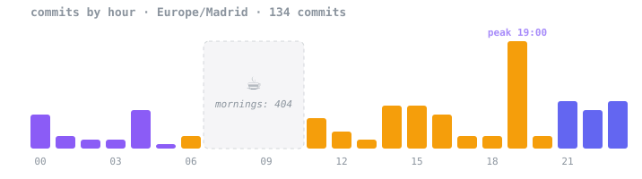

  

### things i made instead of sleeping

**for AI agents**
- [write-as-me](https://github.com/masluny/write-as-me) clones your writing style into a skill, then scores how much the draft actually sounds like you
- [factual-research](https://github.com/masluny/factual-research) research agent that is not allowed to make up a single citation
- [cursor-computer-use](https://github.com/masluny/cursor-computer-use) gives any vision model eyes and hands on a Mac
- [front-design](https://github.com/masluny/front-design) reads what real designers say before it touches your UI
- [Pirrot](https://github.com/masluny/Pirrot) 🏴‍☠️ the bird above + an NVIDIA key rotator for the pi agent

**ML**
- [ripple](https://github.com/masluny/ripple) predicts how one late LOT flight in Warsaw ruins everyone's connection (probabilistic GNN)

**apps & games**
- [horyzont](https://github.com/masluny/horyzont) island driving game in Godot with 143k trees, because 142k looked empty
- [Revind](https://github.com/masluny/video-editor) desktop video editor in Tauri, Rust and FFmpeg
- [OptiTrain](https://github.com/masluny/OptiTrain) reads Apple Health and tells you if today is a training day or a sofa day
- [gridatlas](https://github.com/masluny/gridatlas) the whole world offline, cut into ~4 km windows ([try it](https://masluny.github.io/gridatlas/))

### when i actually code

